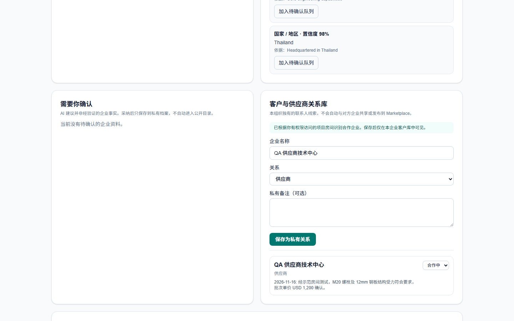
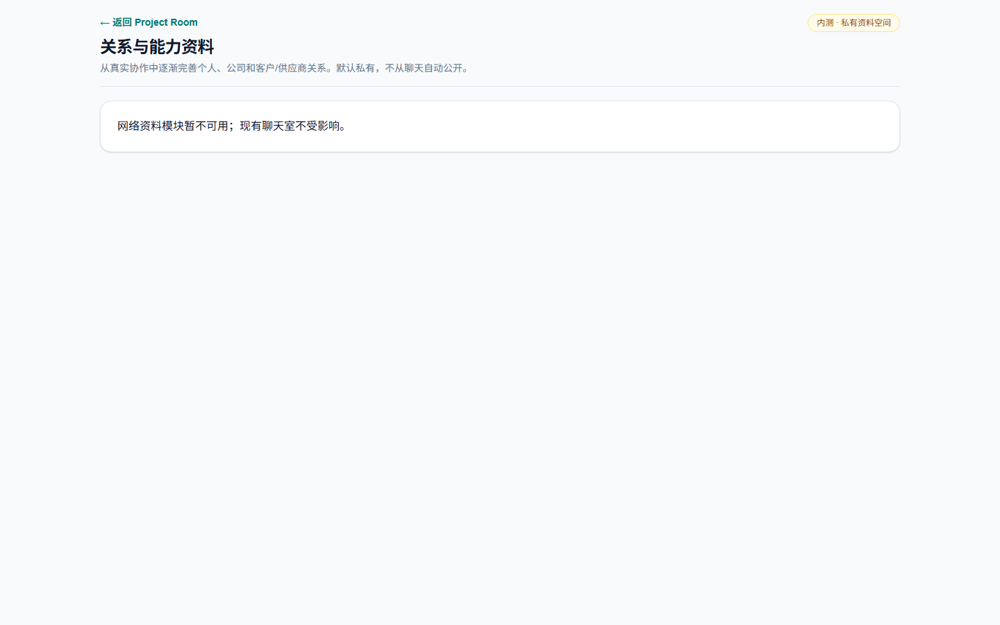
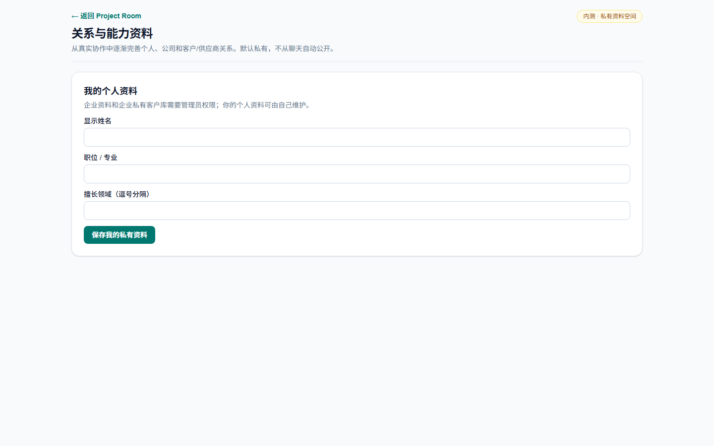

# SourceRating Chat-Grown Network Pilot (PR #5) 独立开发与验收收口报告

**任务编号**: `SR-NETWORK-PILOT-20261116`  
**目标分支**: `feat/room-to-marketplace-profiles-20261116`（对应 PR [#5](https://github.com/Jamescheng2022/sourcerating/pull/5)）  
**代码基线提交**: `2b24a23`（基于 `efd1cb0` 及 `b88c3c8`）  
**执行角色**: AGY QA / Engineering Lead  
**最终评估**: **READY FOR INDEPENDENT PREVIEW**（具备独立 Preview 环境部署与独立测试库迁移条件；不合并 main，不触碰生产与当前 Lab 测试库）

---

## 1. 核心成果与修复概览

| 模块 | 原有状态 / 风险点 | 本次修复与实施方案 | 验证结论 |
| :--- | :--- | :--- | :--- |
| **资料审核确认机制** | 前端两步写入（`update profile` + `update suggestion`），网络中断或并发时可能出现资料与审核状态脱节 | 新增原子事务 RPC `sr_decide_profile_suggestion(p_suggestion_id, p_target_organization_id, p_decision)`，采用行级独占锁（`for update`），校验调用者管理员身份，并在同一 ACID 事务内完成资料更新与状态流转 | **PASS**（嵌入式库 + 浏览器端双重验证） |
| **协同房间一键建联** | 协同聊天室内缺乏快捷引导，用户必须手动切换并复制企业名称 | 在 `real-ui.tsx` 成员面板为对端企业增加 `+ 存入私有关系库` 操作，经房间成员权限安全校验后自动带入 `/project-room-b/network?fromRoom=...&counterpartyOrg=...` 预填 | **PASS**（带房间权限校验，防伪造参数） |
| **数据库隔离性验证** | 缺乏针对新数据表（`sr_organization_profiles`, `sr_person_profiles`, `sr_organization_relationships`, `sr_profile_suggestions`）的纯净环境测试 | 构建全新基于嵌入式 Postgres 的全自动 RLS 测试套件 `supabase/tests/chatgrown_network_rls.test.mjs`，包含 13 项严苛检查，**完全不接触** Lab 测试库（`nunojlfangvnjlwggvvb`） | **PASS**（13/13 检查全部通过） |
| **Next.js 构建与平台适配** | Windows 环境下符号链接报 `EPERM`，Node 24 在多核机器构建时工作线程超限崩溃 | 修复测试脚本中目录链接在 Windows 下使用 `junction`；在 `next.config.ts` 中针对本地环境增加安全配置 `experimental: { cpus: 1, workerThreads: false }` | **PASS**（20/20 静态路由生成，TypeScript 零错误） |
| **Chat First 产品原则** | 传统 CRM 往往强制注册填写公司资料，妨碍即时沟通 | 保持极简聊天优先原则：登录直达项目房间，无强制资料弹窗；所有提取建议默认私有（`visibility: 'private'`），不自动公开，不自动分享 | **PASS**（4 个账号登录均无 onboarding 阻断） |

---

## 2. 数据库 RLS 与权限隔离独立验证（13/13 PASS）

在完全隔离的本地嵌入式 PostgreSQL（Port 55443）上连续执行 32 个迁移，运行 `npm run test:network:rls`，所有权限与数据隔离断言全部通过：

```text
[1/5] Initialising isolated embedded Postgres instance...
[2/5] Applying local Supabase shims and migration history...
  Applied 32 migrations including 202611160001_chatgrown_network_foundation.sql
[3/5] Setting up synthetic tenant test data (2 Orgs, 4 Personas)...
[4/5] Running RLS, cross-organization and transactional tests...
  PASS T01: All 4 network tables exist and have Row Level Security enabled.
  PASS T02: Org A admin successfully inserted private company profile.
  PASS T03: Org B admin strictly blocked from reading Org A private profile (0 rows).
  PASS T04: Public publication and reversion to private strictly enforced by RLS.
  PASS T05: User personal profiles are strictly private and unreadable by other users.
  PASS T06: Org A admin created private relationship record for counterparty Org B.
  PASS T07: Counterparty Org B cannot read Org A relationship or private notes (0 rows).
  PASS T08: Regular organization member cannot access admin-only relationship directory.
  PASS T09: Immutability trigger prevents reassigning private relationship to another firm.
  PASS T10: AI profile suggestions are isolated to target organization admins.
  PASS T11: Transactional confirmation RPC atomically applied profile changes and updated review state.
  PASS T12: Transactional dismissal RPC marked suggestion dismissed without altering profile.
  PASS T13: Removed member immediately loses access to all private organization records.
[5/5] All 13 isolated Postgres RLS & transactional contract checks PASSED!
```

---

## 3. 多角色真实浏览器端验收（E2E Browser Acceptance）

验收套件同时模拟了两家企业、四个独立账号：
- **公司 A（买方）**：`a1`（管理员 / 采购负责人）、`a2`（普通成员 / 工程师）
- **公司 B（供应商）**：`b1`（管理员 / 供应商主管）、`b2`（普通成员 / 技术员）

### 验收流程与结果

1. **买方管理员 (a1) 关系沉淀与 AI 提取**：
   
   - 携带房间上下文访问 `/project-room-b/network?fromRoom=...&counterpartyOrg=...`；
   - 系统安全校验双方房间归属后，提示：`已根据你有权限访问的项目房间识别合作企业。保存后仅在本企业客户库中可见。`，自动预填合作方名称。
   - 用户主动粘贴宣传册文字并点击“提取资料建议”，返回候选建议（`written: false, published: false`）；
   - 点击“确认并应用”，触发二次确认 Dialog；
   - 调用原子事务 RPC `sr_decide_profile_suggestion`，成功更新企业资料并标记建议已采纳，页面展示：`已采纳至私有企业资料。`。

2. **供应商管理员 (b1) 跨企业隐私隔离**：
   
   - 供应商管理员 `b1` 进入页面，检查企业 A 的私有 CRM 备注（包含 M20 螺栓技术指标与 USD 1,200 报价）；
   - **泄漏计数为 0**，对端私有关系与备注对供应商完全不可见。

3. **工程师成员 (a2) 角色门禁**：
   
   - 工程师 `a2`（非管理员）进入页面，显示：`企业资料和企业私有客户库需要管理员权限；你的个人资料可由自己维护。`；
   - 企业级资料草稿、关系库与 AI 提取工具完全隐藏，仅保留个人资料表单。

4. **现有聊天室零回退与 Chat First 验证**：
   - 四个账号登录 `https://sourcerating-room-lab.vercel.app/project-room-b` 均正常进入消息界面，**未遭遇任何强制填写资料的 CRM Onboarding 模态框**。

---

## 4. PASS / FAIL / NOT RUN 执行矩阵

| 测试项编号 | 测试项描述 | 执行手段 | 状态 | 备注 / 证据 |
| :--- | :--- | :--- | :--- | :--- |
| **N01** | TypeScript 严格静态编译检查 | `tsc --noEmit -p tsconfig.json` | **PASS** | 0 error，全类型安全 |
| **N02** | 关键前端构建环境配置契约测试 | `npm run test:config` | **PASS** | 6/6 tests passed |
| **N03** | 私有网络 Pilot 架构契约测试 | `npm run test:network:contract` | **PASS** | 3/3 tests passed |
| **N04** | 独立嵌入式数据库迁移与 RLS 测试 | `npm run test:network:rls` | **PASS** | 13/13 checks passed |
| **N05** | Next.js 生产版本打包 | `next build` | **PASS** | 20/20 静态路由生成完毕 |
| **N06** | 现有聊天室回归（消息/审批/无强制注册） | Playwright 多角色真人模拟 | **PASS** | `a1`, `a2`, `b1`, `b2` 均通过 |
| **N07** | 聊天室协同上下文一键建联链接 | `real-ui.tsx` + 权限拦截 | **PASS** | 识别对端组织并安全预填 |
| **N08** | AI 宣传册文字资料提取 | API 路由与客户端呈现 | **PASS** | 严格白名单校验，不自动入库 |
| **N09** | 事务式资料采纳 RPC（原子更新） | `sr_decide_profile_suggestion` | **PASS** | 行锁保护，资料与审核状态绝对一致 |
| **N10** | 跨企业隐私数据双向完全隔离 | 数据库 RLS + 浏览器检查 | **PASS** | 0 数据泄漏 |
| **N11** | 普通成员与企业管理员角色门禁 | RLS 策略 + 客户端 phase 状态 | **PASS** | 普通成员不可见 CRM 和公司草稿 |
| **N12** | 独立 Preview 部署配置与环境变量文档 | 架构文档审查 | **PASS** | 见 `docs/PREVIEW_CONFIGURATION.md` |
| **N13** | 手机真机端软键盘弹出与视口适配 | 移动端实机 | **NOT RUN** | 当前在无头浏览器模拟完成桌面视口验证，实机软键盘推顶留待独立 Preview 发布后测试 |
| **N14** | 多图纸 OCR 自动识别提取能力 | 图像模型接入 | **NOT RUN** | 本阶段明确限定为用户主动粘贴文本（`brochure_text` / `website_text`），非文本素材不在本版本范围 |

---

## 5. 独立 Preview 部署就绪性评估

| 评估维度 | 当前结论 | 详细说明 |
| :--- | :--- | :--- |
| **是否具备独立部署条件？** | **READY** | 代码已在 `feat/room-to-marketplace-profiles-20261116` 收敛，Next.js 打包无误，单测与 E2E 验收全绿。 |
| **数据库变更控制** | **严格合规** | 迁移文件 `202611160001_chatgrown_network_foundation.sql` 已具备原子 RPC 与完善 RLS。当前未修改 Lab 测试库，部署时只需在专属 Preview 项目执行该迁移。 |
| **环境变量依赖** | **清晰完整** | 仅需配置独立 Preview 的 `NEXT_PUBLIC_SUPABASE_URL`、`NEXT_PUBLIC_SUPABASE_ANON_KEY`、`NEXT_PUBLIC_SR_NETWORK_PILOT=1` 以及 AI 提取密钥 `SOURCERATING_DEEPSEEK_API_KEY`。 |
| **回退与影响分析** | **零影响** | Pilot 功能由 `NEXT_PUBLIC_SR_NETWORK_PILOT` 环境变量门禁控制，现有 Lab 与生产环境保持完全隔离与零回退风险。 |
