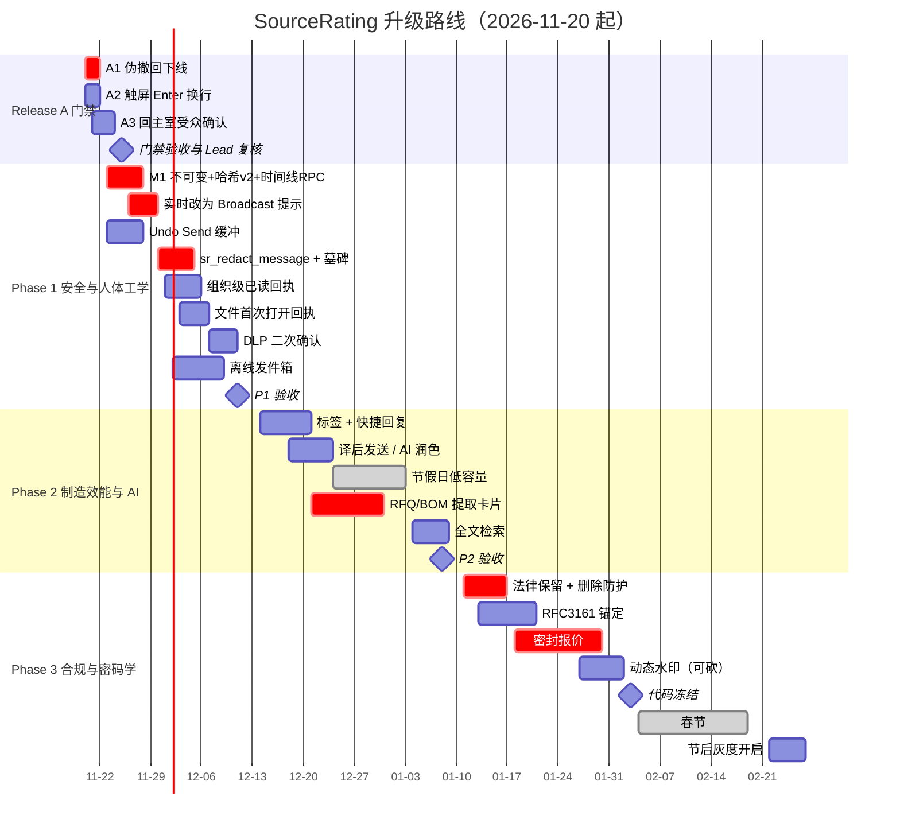
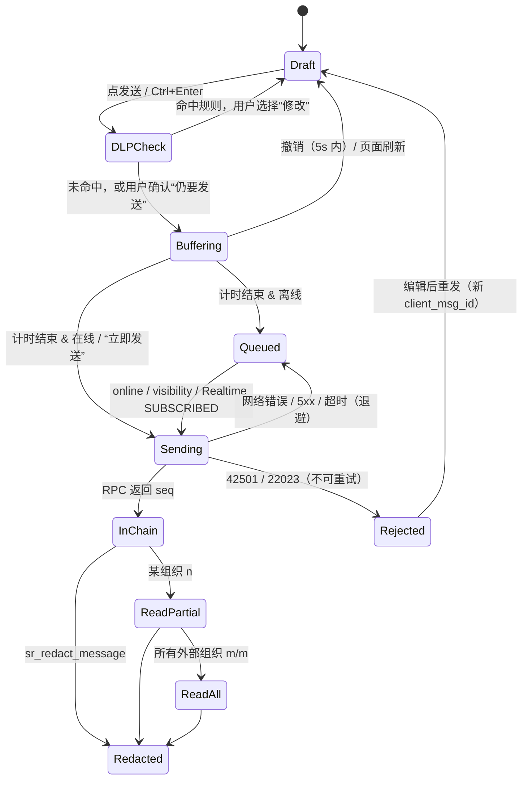

# SourceRating 全面升级改造规划与执行路线图

| 项 | 值 |
|---|---|
| 基线 | `candidate/release-a-launch-20261118` @ `f0cc796` |
| 输入 | 《SourceRating 对比 WhatsApp Business：产品与技术架构评审》 |
| 范围 | `apps/web/src/app/project-room-b`、`project-room-lab`、`api/project-room*`、`supabase/migrations`、`supabase/functions` |
| 日期 | 2026-11-20 |
| 状态 | 草案，待 Owner 审批（见 §10 待决策项） |
| 授权边界 | 本文是规划文件。它不授权支出、生产迁移、外部发送或发布。所有生产动作仍须经过项目现有的门禁和 Owner 批准。 |

---

## 0. 结论摘要

1. **护城河是“可证明的协作”，不是聊天体验。** 我们借鉴 WhatsApp 的人体工学（速度、Undo、快捷回复、标签），但不采用它的语义（“对所有人删除”）。凡是已进入事件链的内容，只能被追加的新事件**更正或折叠**，不能被修改或删除。
2. **Release A 只剩 3 项门禁，其中 1 项是 P0 合规问题。** 当前的“Recall”只从本地状态过滤掉消息（`use-real.ts:428`），对方仍能看到原消息，但界面却提示“Message recalled”。这是虚假承诺，必须在上线前下线。
3. **Phase 1 的地基是一次读路径迁移。** 只有当客户端不再直接 `select * from room_events`、实时通道不再推送完整 payload 时，撤回（redaction）才对后来读取的人真正生效。这项迁移决定了 Phase 1 的关键路径。
4. **哈希链需要升级到 v2。** v1 的 `content_hash` 直接包含 payload 原文，并把 `timestamptz::text` 计入哈希（其格式受会话 `TimeZone` 和 `DateStyle` 影响）。v2 改为哈希 `payload_hash`，并使用 UTC ISO 时间。这样，内容被撤回后哈希链仍可由第三方独立验证。
5. **日历（12 周加缓冲）：**
   - Release A 门禁：11-20 → 11-25
   - Phase 1：11-23 → 12-11
   - Phase 2：12-14 → 01-08（含圣诞和元旦，有效工期约 3.2 周）
   - Phase 3：01-11 → 02-05
   - 春节（2027-02-06）前代码冻结，节后 02-22 起灰度开启
6. **人力合计约 172 人日（约 7.8 人月，人类工程师当量）。** 后端是关键路径，超载约 28%。预设的砍项是：动态水印顺延，全文检索降级为仅 `pg_trgm` 的 MVP。

---

## 1. 现状基线（代码事实）

以下事实已在 `f0cc796` 上逐项核对。后文的设计都以它们为前提。

| # | 事实 | 位置 | 对规划的影响 |
|---|---|---|---|
| F1 | `room_events` 采用只追加加哈希链设计：`prev_hash`、`content_hash`、`rooms.digest_head`，并有 `unique(room_id, seq)` 和 `unique(room_id, client_msg_id)` | `202609250001_p1_room_core.sql:64-88` | 存证基础已具备，可以直接复用 |
| F2 | `authenticated` 角色没有 `room_events` 的 insert/update/delete 权限 | `202609250001…:427` | 客户端无法篡改 |
| F3 | UPDATE 触发器只保护发送者身份列，`payload`、`content_hash` 对 `service_role`/`postgres` 仍可修改；也没有 DELETE 或 TRUNCATE 防护 | `20261010081312_b8…:34-47` | **缺口**：需要全量不可变触发器 |
| F4 | `room_events.room_id` 外键为 `on delete cascade`，全部迁移里共有 31 处 cascade | `202609250001…:66` | **缺口**：删除房间会连带抹除证据链，与法律保留冲突 |
| F5 | 事件类型的 check 约束已预留 `message.edited` 和 `message.redacted`，但没有任何写入方或渲染方 | `202611130001…:38-43` | 撤回机制可以沿用已预留的类型 |
| F6 | v1 哈希包含 `v_now::text` 和 `payload::text` | `202609250001…`（`append_room_event`） | 外部验证脆弱，需要 v2 |
| F7 | **伪撤回**：自己的消息菜单里有“Recall”，实现只是本地 `filter`，同时 toast 提示“Message recalled” | `project-room-lab/message.tsx:106-116`，`project-room-b/use-real.ts:428` | **P0** |
| F8 | 回车即发送（Shift+Enter 换行），触屏端没有区分 | `project-room-lab/chat.tsx:254` | P1：触屏端应改为 Enter 换行 |
| F9 | 内部室“Send to Main Room”一键直发，没有受众确认 | `project-room-b/real-ui.tsx:466-469` | P1：误发会造成信息外泄 |
| F10 | 服务端 `sr_share_to_parent` 对内部室会剥离来源引用（正确），但正文原样外发 | `202611130001…`（`sr_share_to_parent`） | 服务端需要受众摘要校验 |
| F11 | 已读状态是个人水位 `room_members.last_read_seq` 加 `sr_mark_room_read(uuid, bigint)`，没有组织级聚合 | `202611130001…:50, 475-481` | 组织级回执可以基于水位推导，无需逐条存储 |
| F12 | 待发队列是内存中的 `Map`（`pending.current`），在 `online` 或 `visibilitychange` 时恢复；刷新页面即丢失 | `use-real.ts:109, 323` | 需要持久化的离线发件箱 |
| F13 | 实时通道使用对 `room_events` 的 `postgres_changes`，推送完整 payload | `use-real.ts:283-284`；`202609260001…:4` | 撤回后仍可能泄露，需要改为“提示 + 拉取”模式 |
| F14 | 客户端和 API 直接读表 `room_events` | `use-real.ts:164,260,311,436`；`api/project-room-b/assist/route.ts:62,72`；`lib/staging.ts:29` | 需要统一迁移到脱敏读取 RPC |
| F15 | `audit_log` 已存在（bigint identity，含 org/room/project 维度） | `202609250001…:105-116` | **复用**，不新建 `audit_events` |
| F16 | 文件访问统一经过 `room-file-gateway` 的 sign 动作；存储侧 SELECT 策略要求 `verification_status='verified'` | `supabase/functions/room-file-gateway`；`202611180003…` | 文件打开回执的挂载点 |
| F17 | 已有 `staging_proposals`、`canonical_objects`、`review_staging_proposal`，以及 `proposal.created/reviewed` 事件 | 多个迁移 | RFQ/BOM 提取应复用这条管线 |
| F18 | AI 助手已有 `translate` 模式（仅接收侧，单房间上下文） | `assist/route.ts:15-47` | 可以扩展出译后发送 |
| F19 | 文件版本有 lineage 校验（`supersedes_version_id`），并有 `room_file_orphan_object` | `202611150001…` | Undo 期间取消上传时可复用孤儿清理 |
| F20 | 删除、保留期和法律保留都没有实现，并被明确标记为“待决的上线政策输入” | `docs/ROOM_ARCHIVE_AND_DELETION.md` | Phase 3 必须先定政策再写代码 |
| F21 | 202611180003 刚刚收敛了 RPC 重载 | `202611180003_consolidate_security_and_close_overloads.sql` | **新接口不得引入重载**，签名变化采用“新名并行，再收缩旧名” |

---

## 2. 总体升级战略与原则

### 2.1 可证明的协作 vs 个人消费级即时通讯

| 维度 | WhatsApp（含 Business） | SourceRating |
|---|---|---|
| 主体 | 个人手机号 | **组织**：每条事件绑定 `actor_organization_id`，身份快照不可改 |
| 消息性质 | 会话，可“对所有人删除” | **承诺记录**，只能追加更正 |
| 信任模型 | 端到端加密，保证隐私，但平台和第三方都无法证明内容 | **可验证完整性**：哈希链、外部时间戳和可导出证据，同时按房间和组织做范围隐私 |
| 已读 | 个人蓝勾 | **组织法定送达**：“甲方采购部 2/2 已读”，并作为证据记录 |
| 文件 | 媒体，会压缩 | **版本化证据**：sha256、lineage、双方组织独立确认 |
| 多方 | 群聊，所有人互见 | **主权隔离**：每个供应商单独一个外部室，内部室为组织私有，跨室流动必须显式确认 |
| AI | 无，或仅限客服机器人 | **单房间作用域**，AI 产出始终是草稿，AI 参与情况写入元数据 |

**产品命题**：WhatsApp 能证明“你发过消息”。SourceRating 要证明“哪两个组织、在什么时刻、针对哪个文件版本，确认了什么”。所有 Phase 都只服务于这个命题。凡是削弱它的“体验对齐”需求，一律降级或拒绝。

### 2.2 存证不可篡改原则

| 编号 | 原则 | 工程约束 |
|---|---|---|
| I1 | **只追加** | 任何角色（包括 `service_role`）对 `room_events` 都没有 UPDATE、DELETE 或 TRUNCATE。只在经过评审的迁移中设置 `sr.event_maintenance=on` 时放行 |
| I2 | **用新事件更正** | 编辑写成 `message.edited`，撤回写成 `message.redacted`，两者都引用 `target_event_id`、`target_seq` 和 `target_content_hash` |
| I3 | **不物理删除** | 证据表外键全部改为 `on delete restrict`。房间只能归档（`archived_at`）。物理清除不在本路线图范围内，需要另立法律流程 |
| I4 | **事实层与展示层分离** | 时间线 RPC 可以折叠或隐藏内容，但事件“存在”、时间、发送方和哈希永远可见，也永远可导出 |
| I5 | **可信时间** | 服务端使用 `clock_timestamp()`，按 UTC ISO 写入哈希；Phase 3 再锚定外部 TSA |
| I6 | **哈希承诺** | v2 哈希的是 `payload_hash`。撤回后原文对对方不可读，但对方若自留副本，可以用 `payload_hash` 证明副本与原文一致。平台不能凭空篡改，也无法否认 |

#### 撤回与撤销的界限

| 能力 | 发生时点 | 是否入链 | 对方看到什么 | 证据导出 | 权限 | 时限 |
|---|---|---|---|---|---|---|
| **Undo Send**（撤销发送） | 入链之前（客户端缓冲 5 秒） | 否 | 什么都看不到 | 无记录（因为从未发生） | 发送者本人 | 5 秒（可设为 0、5 或 10 秒） |
| **丢弃失败消息** | 发送失败，未入链 | 否 | 什么都看不到 | 无 | 本人 | 不限 |
| **Redact**（撤回） | 入链之后 | 是，`message.redacted` | 墓碑：“张三（乙方工厂）于 14:02 撤回了一条消息 · 误发”，原文不可读 | 保留存在、哈希和撤回原因；原文只进入**发送方组织**的证据导出 | 发送者本人（24 小时内）；发送方组织的 owner/admin（不限时） | 见左 |
| **Edit**（编辑，Phase 2 可选） | 入链之后 | 是，`message.edited` | 新文本加“已编辑”，所有成员可查看历史 | 全部版本 | 本人 | 15 分钟 |
| **物理清除** | — | — | — | — | **本路线图不提供** | — |

硬性规则：

- **不得撤回的情形**：消息已被 `confirmation.recorded`、`proposal.created` 或密封报价引用时，服务端返回 `redaction_blocked_by_commitment`，界面引导用户“发送更正说明”。
- **诚实文案**：撤回前，确认面板必须显示对方组织当时的已读状态，例如“乙方工厂 2/3 已读。撤回只隐藏显示，不能保证对方未看到。”
- 撤回事件的 payload 会快照撤回时刻各组织的已读状态（`audience_read_at_redaction`）。日后发生争议时，可以据此证明“撤回时对方是否已读”。
- 不允许撤回其他组织的消息，平台运营人员也不行。

### 2.3 外部主室与内部室的边界控制

房间分类沿用 `sr_room_is_internal()`：内部为 `internal` 和 `buyer_internal`；其余（`main`、`external`、`supplier_external`、`provider_external`、`shared_execution`）都视为外部。

| 编号 | 规则 | 落地 |
|---|---|---|
| B1 | **只有一条显式通道** | 内部室到主室只能走 `sr_share_to_parent_confirmed`。客户端必须提交服务端计算的 `audience_digest`；服务端在同一事务里重算，不一致时返回 `audience_changed`（防止检查与使用之间的竞态） |
| B2 | **没有隐式流动** | 不支持跨房间回复、引用或转发；不支持跨房间引用文件（必须在目标室重新登记为新文件版本，并保留 lineage）；AI 上下文只限当前房间 |
| B3 | **防串供** | 每个供应商使用独立的外部室；供应商看不到其他供应商的组织、成员或存在。DLP 规则 R3 检测在某供应商室提到其他供应商名称的情况。密封报价（Phase 3）解决报价阶段的平台侧泄露 |
| B4 | **组织私有数据** | 标签、快捷回复、DLP 放行记录和个人已读明细都按 `organization_id` 加 RLS 隔离，任何跨组织视图都不得 join 这些数据 |
| B5 | **已读回执的可见粒度** | 本组织成员看得到“谁读了”；对方组织只看到“某组织 n/m 已读”，看不到姓名，以免施压，也保护隐私 |
| B6 | **审计不外泄** | DLP 放行和受众确认写入 `audit_log`（组织私有），**不写入房间事件链**，否则会把“我方内部曾犹豫”泄露给对方 |
| B7 | **回归门禁** | 每个 Phase 都必须通过隔离用例集（§9.2）：跨组织读取标签、模板、回执明细的结果为 0 行；供应商 A 看不到供应商 B；内部室的来源引用不会出现在主室 payload 中 |

---

## 3. 阶段化路线与时间表

### 3.1 总甘特



### 3.2 立即执行：Release A 门禁收敛（11-20 → 11-25）

| ID | 级别 | 改动 | 文件 | 验收 | 工作量 |
|---|---|---|---|---|---|
| **A1** | **P0** | 对已入链的消息**移除**“Recall”动作，并删除“Message recalled”提示。`actions.remove` 只用于状态为 `failed` 或 `queued` 的消息，菜单文案改为“删除未发送消息”。已发送消息的菜单不提供任何删除类动作 | `project-room-lab/message.tsx:106-116`；`project-room-b/use-real.ts:428`（加入 `status !== "sent"` 守卫，否则 no-op） | ① 全站 grep 不到 `recalled`、`Recall` 文案；② 双会话 Playwright 用例：A 发消息，A 的菜单里没有 Recall，B 可见；③ 失败消息可以删除，且不发起网络请求 | 前端 0.5 天，测试 0.5 天 |
| **A2** | P1 | 当 `matchMedia("(pointer: coarse)")` 为真且 `(pointer: fine)` 为假时，Enter 插入换行，只能点按钮发送；textarea 设置 `enterKeyHint="enter"`。桌面端保持 Enter 发送。任何设备上 Ctrl/⌘+Enter 都发送。保留 `isComposing` 守卫 | `project-room-lab/chat.tsx:254` | 390px 触屏模拟下 Enter 换行；输入法组字时 Enter 不发送；1440px 下 Enter 发送 | 前端 0.5 天，测试 0.5 天 |
| **A3** | P1 | 点“Send to Main Room”后打开**受众确认模态框**：显示目标主室名称、组织列表（含各自人数）、全文预览和字数。主按钮写成“确认发送给 3 个组织”。Esc 或点遮罩会取消；不提供“下次不再提示”。Release A 版本只在客户端拦截，服务端摘要校验放在 P1-W1 | `project-room-b/real-ui.tsx:466-469`；`use-real.ts:525` | 不确认就不会调用 RPC；模态框列出的组织与主室成员一致；移动端模态框为底部 Sheet，按钮至少 44px | 前端 1 天，测试 0.5 天 |

门禁通过条件：

- 现有验收套件 `ALL_PASS`，新增 A1–A3 共 6 个用例通过
- Preview 部署后附截图证据，包括 390px 和 1440px
- Lead 独立复核通过
- 不修改任何迁移

### 3.3 Phase 1：高危安全与通讯人体工学（W1–W3，11-23 → 12-11）

#### 周计划

| 周 | 后端（Codex） | 前端（AGY） | 测试与门禁 |
|---|---|---|---|
| **W1** 11-23 → 11-27 | **M1 迁移**：不可变触发器、哈希 v2、`room_message_projection`、`sr_room_timeline`、`sr_room_audience`、`sr_share_to_parent_confirmed` | Undo 缓冲状态机、A3 接入服务端摘要、读路径改用 `sr_room_timeline` | 迁移在 Supabase branch 上预演；哈希 v1/v2 双版本验证脚本 |
| **W2** 11-30 → 12-04 | Broadcast 提示触发器加 `realtime.messages` RLS；`sr_redact_message`；`message_receipts` 与改造后的 `sr_mark_room_read`；gateway 打开回执 | 墓碑渲染、撤回确认 Sheet、组织级已读标识、离线发件箱（IndexedDB 加 Web Locks） | 撤回后新成员读取不到原文；实时提示中不含 payload |
| **W3** 12-07 → 12-11 | 收缩阶段准备（最低客户端版本检查）；export 增加 `hash_version`、`payload_hash`、撤回信息 | DLP 二次确认；触屏 Action Sheet 规范落地；离线恢复与对账 | 全量回归、隔离用例集、弱网和断网用例；**P1 门禁 12-11** |

#### 工作项

| ID | 功能 | 关键设计 | 依赖 | 完成定义（DoD） |
|---|---|---|---|---|
| P1-1 | 5 秒 Undo Send | 详见 §4.3。`client_msg_id` 在进入缓冲时生成，重试期间保持不变。文件字节可以在缓冲期内预上传，但 `register_room_file_version` 在缓冲结束后才调用；取消时调用孤儿清理 | 无 | 撤销后服务端 0 次 RPC；刷新页面时缓冲中的消息回到草稿而不是被发出；`beforeunload` 有提示 |
| P1-2 | 服务端撤回 | `message.redacted` 事件、投影表、时间线脱敏、Broadcast 提示（§4.2.1） | M1，实时改造 | 对方、后加入成员、AI 助手和全文检索都读不到原文；导出仍可验证哈希链 |
| P1-3 | 组织级已读 | 基于水位推导，回执日志只追加（§4.1.3） | M1 | “甲方采购部 2/2 已读”；对方只看到计数；`mark_read` 的 p95 < 50ms |
| P1-4 | 文件打开回执 | gateway 签发 URL 时调用 `sr_record_file_access`；某组织首次访问某版本时追加 `file.first_accessed` 链上事件，之后的访问只写回执表 | M1 | 文件卡片显示“乙方工厂于 11-30 14:02 首次获取 v3”。文案写“获取”，因为服务端无法证明对方“阅读”过 |
| P1-5 | DLP 二次确认 | 客户端规则引擎（§4.3.4）；放行记录写入 `audit_log` | P1-1 | 命中时高亮命中片段并列出受众；放行后才进入缓冲；明确说明这是人体工学护栏，不是安全边界 |
| P1-6 | 离线发件箱 | IndexedDB `sr-outbox-v1`、Web Locks 单写者、指数退避、按 `client_msg_id` 幂等对账（§4.3.3） | P1-1 | 断网发送 3 条后刷新、恢复网络，3 条按顺序入链，无重复；退出登录时清空 |

### 3.4 Phase 2：B2B 制造效能与 AI 协作（W4–W7，12-14 → 01-08）

> 12-24 至 01-03 期间按 30% 容量计划，生产发布冻结（Preview 照常）。中国供应商侧在 12 月是旺季，适合收集试点反馈。

| 周 | 交付 |
|---|---|
| **W4** 12-14 → 12-18 | `organization_labels` 及分配表加 RLS；`quick_reply_templates` 加变量解析器；会话列表按标签筛选；在输入框中用 `/` 唤起快捷回复 |
| **W5** 12-21 → 12-23（节前） | 译后发送和 AI 润色（数字与料号守恒校验）；`sr_post_room_message` 的 payload 白名单扩展 `source_text`、`source_lang`、`assist` |
| **W6** 12-28 → 01-01（低容量） | RFQ/BOM 提取：复用 `staging_proposals` 和 `canonical_objects`，产出 `rfq.v1` schema，做结构化确认卡片，并准备 50 份合成 RFQ 金标集 |
| **W7** 01-04 → 01-08 | 全文检索（先确认 PGroonga 可用性，降级方案为 `pg_trgm`）；RFQ 双方确认生成 `object.version_committed`；**P2 门禁 01-08** |

| ID | 功能 | 关键设计 | DoD |
|---|---|---|---|
| P2-1 | 快捷回复 | 组织共享或个人私有；同一 `group_key` 下的多语言版本；变量 `{part_no}`、`{qty}`、`{incoterm}` 等（§4.1.2） | 未解析的变量会阻止发送并内联提示；Incoterms 2020 白名单校验；跨组织读取为 0 行 |
| P2-2 | 组织私有标签 | 按“询价 / 打样 / 试产 / 量产 / 售后”五阶段预置，并可自定义；用复合外键防止跨组织挂标签（§4.1.1） | 对方组织完全不可见；单个房间标签数不超过 10 |
| P2-3 | 译后发送与 AI 润色 | 原文和译文都入链（默认，见 D3）。所有数字、料号、单位和 Incoterm 必须集合相等，否则阻止发送并显示差异。AI 结果始终是可编辑的草稿，不会自动发送 | 金标集上数字守恒 100%；payload 中有 `assist.kind/model`；撤回内容不会进入 AI 上下文 |
| P2-4 | RFQ/BOM 提取 | AI 生成 `staging_proposals(kind='rfq.v1')`；每个字段带置信度和来源跨度（`event_id` 加字符区间）；双方组织逐字段确认后，记录 `confirmation.recorded` 和对象版本 | 字段级精确率不低于 95%（金标集）；数值精确匹配 100%，或标为低置信并强制人工确认 |
| P2-5 | 全文检索 | 派生投影表 `room_event_search`（非证据，可删可重建）；撤回时删除对应行；查询 RPC 内部强制 `is_room_member` | 中文两字词可以召回；撤回内容 0 命中；p95 < 300ms（10 万条） |

### 3.5 Phase 3：企业级合规与密码学增强（W8–W12，01-11 → 02-05）

| 周 | 交付 |
|---|---|
| **W8** 01-11 → 01-15 | 法律保留：`legal_holds` 表、房间和项目上的标志位、外键改为 restrict、删除和存储防护触发器；**先签 D5 政策决策** |
| **W9** 01-18 → 01-22 | RFC 3161 锚定：每小时 Merkle 根，通过现有 agent scheduler 调度；导出中包含包含性证明和 TSR |
| **W10–W11** 01-25 → 02-03 | 密封报价：drand tlock 时间锁加密，链上提交承诺，开标时生成事件；同时完成安全评审 |
| **W11** | 动态水印（**可砍项**）：gateway 输出派生件并登记派生哈希 |
| **02-03** | 代码冻结。春节期间（约 02-04 至 02-19）不做生产变更 |
| **02-22 →** | 节后按灰度环逐步开启 |

| ID | 功能 | 关键设计 | DoD |
|---|---|---|---|
| P3-1 | 法律保留 | §4.1.4。保留历史只追加；解除保留需双人控制（两名 owner/admin，或 owner 加平台合规）；保留期间禁止归档以外的任何破坏性动作，也禁止删除存储对象 | 在保留中的项目上尝试删除房间、文件或成员组织，均被数据库拒绝（不能只靠界面拦截） |
| P3-2 | 外部时间戳锚定 | 每个房间的 `digest_head` 变化后，每小时汇总成全局 Merkle 树；根哈希提交 RFC 3161 TSA（生产用商用或合格 TSA；中国争议场景可以选国内可信时间戳服务，见 D4）；可选 OpenTimestamps 作为第二锚点 | 导出包能离线完成验证：事件、哈希链、房间根、全局根和 TSR，并附 CLI 验证脚本 |
| P3-3 | 密封报价 | 威胁模型：开标前**任何一方，包括平台**都不可读。主方案为 drand quicknet 加 tlock：供应商在浏览器内用开标轮次的公钥加密，密文作为文件版本上传，链上记录 `bid.sealed {ciphertext_sha256, round}`；到达轮次后任何人都能解密，服务端校验明文哈希并追加 `bid.opened`。截止时间由服务端 `clock_timestamp()` 判定，迟到的投标直接拒绝。修改投标即生成新的密封版本并覆盖旧版。降级方案为双人托管密钥（见 D7） | 截止前服务端日志、数据库和存储中都不存在明文；各家同时开标；迟到投标被拒绝；供应商之间互不可见 |
| P3-4 | 动态水印 | gateway 下载 PDF 或图片时，生成带“组织 / 用户 / UTC 时间 / 下载 ID”的可见微印和不可见水印的派生件。原件 sha256 不变，派生件哈希写入 `file_access_receipts.derivative_sha256`。网页预览使用平铺 CSS 水印。**诚实说明：网页无法阻止截图**，水印的作用是威慑和事后追溯 | 能从泄露出去的派生件反查下载记录 |

---

## 4. 核心功能技术设计细则

### 4.0 Migration 规范（所有 Phase 适用）

1. **命名**：`YYYYMMDDHHMM_<phase>_<topic>.sql`，例如 `202611230001_p1_event_immutability_hash_v2.sql`。
2. **Expand → Migrate → Contract**：
   - Expand 阶段只做加法（新列带默认值、新表、新函数），保证旧客户端零影响。
   - Contract 阶段（撤销权限、删除旧函数、从 publication 移除）单独成一个迁移，并且只能在最低客户端版本门槛生效之后执行。
3. **每个文件末尾附回滚注释块**，沿用 `202611130001…:642` 的写法。不可回滚的步骤必须显式标为 `-- IRREVERSIBLE:`。
4. **新表**：`enable row level security` 加 `force row level security`；显式 `grant`；`revoke all … from anon, public`。
5. **`security definer` 函数**：使用 `set search_path = ''`，对象名全部写全限定名；`revoke execute … from public, anon`；**不得新增重载**（F21）。
6. **锁安全**：每个迁移开头写 `set local lock_timeout = '3s'; set local statement_timeout = '60s';`。大表建索引另起一个非事务迁移，使用 `create index concurrently`。外键变更先 `not valid`，下一个迁移再 `validate constraint`。
7. **测试**：每个迁移附 SQL 断言脚本，放在 `supabase/functions/tests/` 现有目录下，至少覆盖 RLS 正例、跨组织反例和权限拒绝。所有迁移先在 Supabase branch 上预演，通过后才能进入 staging。

### 4.0.1 M1：不可变性与哈希 v2（P1-W1）

```sql
-- 202611230001_p1_event_immutability_hash_v2.sql
set local lock_timeout = '3s';

alter table public.room_events
  add column if not exists hash_version smallint not null default 1
    check (hash_version in (1, 2)),
  add column if not exists payload_hash text
    check (payload_hash is null or payload_hash ~ '^[0-9a-f]{64}$');

-- I1：任何角色都不能改写或删除事件，只在经过评审的维护迁移中放行
create or replace function public.sr_forbid_event_mutation()
returns trigger language plpgsql set search_path = '' as $$
begin
  if coalesce(current_setting('sr.event_maintenance', true), '') = 'on' then
    return coalesce(new, old);
  end if;
  raise exception 'room_events_append_only' using errcode = '42501';
end; $$;
revoke all on function public.sr_forbid_event_mutation() from public, anon, authenticated;

create trigger room_events_no_update before update on public.room_events
  for each row execute function public.sr_forbid_event_mutation();
create trigger room_events_no_delete before delete on public.room_events
  for each row execute function public.sr_forbid_event_mutation();
create trigger room_events_no_truncate before truncate on public.room_events
  for each statement execute function public.sr_forbid_event_mutation();

-- 新事件类型（与 202611130001 的列表保持超集关系）
alter table public.room_events drop constraint if exists room_events_event_type_check;
alter table public.room_events add constraint room_events_event_type_check check (event_type in (
  'message.posted','message.edited','message.redacted','file.attached',
  'proposal.created','proposal.reviewed','object.version_committed',
  'member.joined','member.removed',
  'room.summary_shared','file.review_requested','confirmation.recorded',
  'file.first_accessed','room.legal_hold_changed','bid.sealed','bid.opened'));
```

`append_room_event` 的 v2 哈希片段（整个函数原样重建，只替换哈希计算部分）：

```sql
v_payload      := coalesce(p_payload, '{}'::jsonb);
v_payload_hash := encode(extensions.digest(convert_to(v_payload::text, 'UTF8'), 'sha256'), 'hex');
v_ts           := to_char(v_now at time zone 'UTC', 'YYYY-MM-DD"T"HH24:MI:SS.US"Z"');
v_hash := encode(extensions.digest(convert_to(concat_ws('|',
  'v2', p_room_id::text, v_seq::text, p_client_msg_id::text,
  auth.uid()::text, p_actor_organization_id::text, p_event_type,
  v_payload_hash, coalesce(v_prev_hash, ''), v_ts), 'UTF8'), 'sha256'), 'hex');
-- insert … hash_version = 2, payload_hash = v_payload_hash
```

- **v1 事件永不重算**。验证器同时支持 v1 和 v2；导出中携带 `hash_version`。
- v1 事件撤回后，只有拿到发送方组织的导出才能验证该节点。由于试点数据基本是合成数据，这一点可以接受，并在导出说明中写明。
- 外部验证器使用的规范化方式：`payload_hash` 的输入是 Postgres jsonb 的 `::text` 输出，导出中会附带该字符串，验证器不需要自行重新序列化。

### 4.1 数据库 DDL 预演

#### 4.1.1 `organization_labels` 及分配表

```sql
create table public.organization_labels (
  id              uuid primary key default gen_random_uuid(),
  organization_id uuid not null references public.organizations(id) on delete restrict,
  name            text not null check (length(btrim(name)) between 1 and 40),
  color           text not null default 'slate'
                  check (color in ('slate','blue','green','amber','red','violet','teal')),
  stage           text check (stage in ('rfq','sampling','pilot_run','mass_production','after_sales')),
  sort_order      int  not null default 0,
  created_by      uuid not null references auth.users(id) on delete restrict,
  created_at      timestamptz not null default now(),
  archived_at     timestamptz,
  unique (id, organization_id)                      -- 供复合外键使用
);
create unique index organization_labels_name_uq
  on public.organization_labels (organization_id, lower(btrim(name))) where archived_at is null;

create table public.organization_label_assignments (
  organization_id uuid not null,
  label_id        uuid not null,
  room_id         uuid not null references public.rooms(id) on delete restrict,
  assigned_by     uuid not null references auth.users(id) on delete restrict,
  assigned_at     timestamptz not null default now(),
  primary key (organization_id, label_id, room_id),
  -- 复合外键：标签只能由所属组织使用，结构上杜绝跨组织挂标签
  foreign key (label_id, organization_id)
    references public.organization_labels (id, organization_id) on delete cascade
);
create index org_label_assign_room_idx on public.organization_label_assignments (organization_id, room_id);

alter table public.organization_labels            enable row level security;
alter table public.organization_labels            force  row level security;
alter table public.organization_label_assignments enable row level security;
alter table public.organization_label_assignments force  row level security;

create policy org_labels_select on public.organization_labels
  for select to authenticated using (public.is_org_member(organization_id));
create policy org_labels_write on public.organization_labels
  for all to authenticated
  using (public.is_org_member(organization_id))
  with check (public.is_org_member(organization_id) and created_by = auth.uid());

create policy org_label_assign_select on public.organization_label_assignments
  for select to authenticated using (public.is_org_member(organization_id));
create policy org_label_assign_write on public.organization_label_assignments
  for all to authenticated
  using (public.is_org_member(organization_id))
  with check (
    public.is_org_member(organization_id)
    and assigned_by = auth.uid()
    -- 只能给本组织确有成员在场的房间打标签
    and exists (select 1 from public.room_members rm
                 where rm.room_id = organization_label_assignments.room_id
                   and rm.acting_organization_id = organization_label_assignments.organization_id
                   and rm.removed_at is null));

revoke all on public.organization_labels, public.organization_label_assignments from anon, public;
grant select, insert, update, delete on public.organization_labels, public.organization_label_assignments to authenticated;
```

说明：标签是组织配置而不是证据，所以允许修改和删除。分配表 `room_id` 使用 `restrict`，是为了与 I3 保持一致。

#### 4.1.2 `quick_reply_templates` 与变量解析

```sql
create table public.quick_reply_templates (
  id              uuid primary key default gen_random_uuid(),
  organization_id uuid not null references public.organizations(id) on delete restrict,
  owner_user_id   uuid references auth.users(id) on delete cascade,  -- null 表示组织共享
  group_key       uuid not null default gen_random_uuid(),            -- 同一模板的多语言版本共用
  shortcut        text not null check (shortcut ~ '^/[a-z0-9_-]{1,24}$'),
  locale          text not null default 'zh-CN' check (locale ~ '^[a-z]{2}(-[A-Z]{2})?$'),
  title           text not null check (length(btrim(title)) between 1 and 60),
  body            text not null check (length(body) between 1 and 4000),
  variables       jsonb not null default '[]'::jsonb check (jsonb_typeof(variables) = 'array'),
  version         int  not null default 1,
  created_by      uuid not null references auth.users(id) on delete restrict,
  updated_at      timestamptz not null default now(),
  archived_at     timestamptz
);
create unique index qrt_shared_uq   on public.quick_reply_templates (organization_id, shortcut, locale)
  where archived_at is null and owner_user_id is null;
create unique index qrt_personal_uq on public.quick_reply_templates (owner_user_id, shortcut, locale)
  where archived_at is null and owner_user_id is not null;

alter table public.quick_reply_templates enable row level security;
alter table public.quick_reply_templates force  row level security;
create policy qrt_select on public.quick_reply_templates for select to authenticated
  using (public.is_org_member(organization_id) and (owner_user_id is null or owner_user_id = auth.uid()));
create policy qrt_personal_write on public.quick_reply_templates for all to authenticated
  using (owner_user_id = auth.uid() and public.is_org_member(organization_id))
  with check (owner_user_id = auth.uid() and public.is_org_member(organization_id));
create policy qrt_shared_write on public.quick_reply_templates for all to authenticated
  using (owner_user_id is null and public.sr_org_role(organization_id) in ('owner','admin'))
  with check (owner_user_id is null and public.sr_org_role(organization_id) in ('owner','admin'));
```

**变量解析逻辑**（客户端纯函数，不执行任何代码）：

- **语法**：`{name}` 或 `{name|filter}`，用 `{{` 和 `}}` 表示字面量。变量名必须在白名单里：`part_no`、`description`、`qty`、`unit`、`price`、`currency`、`incoterm`、`port`、`delivery_date`、`moq`、`project_name`、`counterpart_org`、`my_name`。
- **取值优先级**：
  1. 用户在本次发送时手填
  2. 当前房间最新已确认的 `rfq.v1` 对象（`canonical_objects`）
  3. 房间上下文（项目名、对方组织名）
  4. 以上都没有时视为未解析
- **过滤器**：`number`（按模板 locale 用 `Intl.NumberFormat` 格式化）、`date`（ISO 日期加本地化显示）、`upper`。
- **校验**：
  - `incoterm` 必须属于 Incoterms 2020：EXW、FCA、CPT、CIP、DAP、DPU、DDP、FAS、FOB、CFR、CIF
  - `qty` 和 `moq` 必须是正数
  - `currency` 必须是 ISO 4217 代码
- **输出**：存在未解析变量时，**禁止发送**，并在输入框里显示可填写的内联 chip。解析结果仍走正常管线：DLP、Undo 缓冲、发送。模板 ID **不写入**链上 payload，以免泄露对方无需知道的组织内部信息。

```ts
type Vars = Partial<Record<VarName, string | number>>;
export function renderTemplate(body: string, vars: Vars, locale: string):
  { text: string; missing: VarName[]; invalid: { name: VarName; reason: string }[] } { /* 纯函数，单测覆盖 */ }
```

#### 4.1.3 `message_receipts`：组织已读与文件访问

**性能决策**：不按“每条消息 × 每个成员”存储（O(M×N) 写放大），而是**沿用个人水位**（`room_members.last_read_seq`），再加一张**只追加的推进日志**：

```sql
create table public.message_receipts (
  id              bigint generated always as identity primary key,
  room_id         uuid not null references public.rooms(id) on delete restrict,
  organization_id uuid not null references public.organizations(id) on delete restrict,
  user_id         uuid not null references auth.users(id) on delete restrict,
  kind            text not null check (kind in ('read','file_access')),
  up_to_seq       bigint,                 -- kind='read'：本次推进到的水位
  file_version_id uuid references public.room_file_versions(id) on delete restrict,
  derivative_sha256 text,                 -- P3 水印派生件
  created_at      timestamptz not null default clock_timestamp(),
  check ((kind = 'read' and up_to_seq is not null and file_version_id is null)
      or (kind = 'file_access' and file_version_id is not null))
);
create index message_receipts_room_org_idx on public.message_receipts (room_id, organization_id, created_at desc);
create index message_receipts_file_idx     on public.message_receipts (file_version_id, organization_id) where kind = 'file_access';
-- 只追加：复用 sr_forbid_event_mutation() 挂 UPDATE/DELETE/TRUNCATE 触发器
alter table public.message_receipts enable row level security;
alter table public.message_receipts force  row level security;
-- 只有本组织成员能读本组织的明细；跨组织读取一律走聚合 RPC
create policy message_receipts_own_org on public.message_receipts for select to authenticated
  using (public.is_org_member(organization_id) and public.is_room_member(room_id));
revoke insert, update, delete on public.message_receipts from authenticated;
```

**聚合读取**：`sr_room_read_state(p_room_id uuid) returns jsonb`，返回每个组织的 `{org_id, org_name, member_count, watermarks: bigint[]}`，其中 `watermarks` 是降序排列的匿名水位数组。

- 客户端对任一消息 seq 可以用二分得到 `n/m`。
- 对**本组织**额外返回 `members: [{user_id, name, last_read_seq}]`，满足 B5。

**容量估算**：试点规模约 50 个房间 × 10 人 × 每天 30 次推进，约 1.5 万行/天。到 5000 万行之前不需要分区，届时按月分区。`sr_mark_room_read` 只在水位**确实推进**时插入一行；客户端已有的可见性和防抖调用保持不变。

#### 4.1.4 审计与法律保留（复用 `audit_log`）

```sql
-- 保留历史：只追加，解除时追加新行而不改旧行
create table public.legal_holds (
  id            uuid primary key default gen_random_uuid(),
  scope_type    text not null check (scope_type in ('project','room')),
  scope_id      uuid not null,
  action        text not null check (action in ('set','release')),
  matter_ref    text check (length(matter_ref) <= 120),
  reason        text not null check (length(btrim(reason)) between 5 and 1000),
  actor_user_id uuid not null references auth.users(id) on delete restrict,
  actor_organization_id uuid not null references public.organizations(id) on delete restrict,
  approver_user_id uuid references auth.users(id) on delete restrict, -- release 必填（双人控制）
  created_at    timestamptz not null default clock_timestamp(),
  check (action = 'set' or (approver_user_id is not null and approver_user_id <> actor_user_id))
);
-- 反范式快速判断（只能由 sr_set_legal_hold / sr_release_legal_hold 维护）
alter table public.projects add column if not exists legal_hold boolean not null default false;
alter table public.rooms    add column if not exists legal_hold boolean not null default false,
                            add column if not exists archived_at timestamptz;

-- audit_log 本身也只追加
create trigger audit_log_no_update before update on public.audit_log
  for each row execute function public.sr_forbid_event_mutation();
create trigger audit_log_no_delete before delete on public.audit_log
  for each row execute function public.sr_forbid_event_mutation();

-- 删除防护：保留中的项目或房间，以及含证据的房间，都不能被物理删除
create or replace function public.sr_guard_room_delete() returns trigger
language plpgsql set search_path = '' as $$
begin
  if old.legal_hold or exists (select 1 from public.projects p where p.id = old.project_id and p.legal_hold) then
    raise exception 'legal_hold_active' using errcode = '42501';
  end if;
  raise exception 'rooms_archive_only' using errcode = '42501';  -- I3：一律只能归档
end; $$;
create trigger rooms_no_delete before delete on public.rooms
  for each row execute function public.sr_guard_room_delete();
```

外键收紧分两个迁移进行，以避免长锁：

```sql
-- 迁移 A
alter table public.room_events drop constraint room_events_room_id_fkey,
  add constraint room_events_room_id_fkey foreign key (room_id)
  references public.rooms(id) on delete restrict not valid;
-- 迁移 B
alter table public.room_events validate constraint room_events_room_id_fkey;
```

对 `room_file_versions`、`room_confirmations`、`staging_proposals`、`needs_you` 等表做同样处理。31 处 cascade 需要逐个分类，形成迁移清单（工作项 P3-1a）。存储侧对 `storage.objects` 的 DELETE 策略增加“对应 `room_file_versions` 所在房间未处于保留状态”的条件。

### 4.2 API / RPC 接口设计

所有 RPC 遵循以下约定：

- `security definer` 加 `set search_path = ''`
- 显式传入 `p_actor_organization_id`，并校验 `room_members` 绑定关系
- 写操作带 `p_client_msg_id` 以保证幂等
- 错误码沿用现有风格：`42501` 表示权限，`22023` 表示参数

#### 4.2.1 `sr_redact_message`

用户要求的签名是 `(room_id, message_id, reason)`。在此基础上补齐行为主体组织和幂等键，与现有 RPC 规范保持一致。

```sql
create or replace function public.sr_redact_message(
  p_room_id uuid,
  p_message_event_id uuid,
  p_actor_organization_id uuid,
  p_client_msg_id uuid,
  p_reason_code text,          -- wrong_recipient | wrong_content | sensitive_data | duplicate | other
  p_reason_note text default null)
returns public.room_events
language plpgsql security definer set search_path = '' as $$
declare v_t public.room_events; v_role text; v_ev public.room_events; v_read jsonb;
begin
  if auth.uid() is null then raise exception 'authentication_required' using errcode = '42501'; end if;
  v_role := public.sr_room_role(p_room_id, p_actor_organization_id);
  if v_role is null or v_role = 'viewer' then raise exception 'room_write_denied' using errcode = '42501'; end if;
  if p_reason_code not in ('wrong_recipient','wrong_content','sensitive_data','duplicate','other') then
    raise exception 'invalid_reason_code' using errcode = '22023'; end if;

  select * into v_t from public.room_events
   where id = p_message_event_id and room_id = p_room_id and event_type = 'message.posted'
   for share;                                  -- 与并发的确认引用串行化
  if not found then raise exception 'message_not_found' using errcode = '22023'; end if;

  -- 幂等：已经撤回过就返回原撤回事件
  select e.* into v_ev from public.room_message_projection p
    join public.room_events e on e.id = p.redaction_event_id
   where p.event_id = v_t.id;
  if found then return v_ev; end if;

  -- 权限：本人 24h 内，或发送方组织的 owner/admin；其他组织的成员一律不可
  if not ( (v_t.actor_user_id = auth.uid() and v_t.actor_organization_id = p_actor_organization_id
            and v_t.created_at > clock_timestamp() - interval '24 hours')
        or (v_t.actor_organization_id = p_actor_organization_id
            and public.sr_org_role(p_actor_organization_id) in ('owner','admin')) ) then
    raise exception 'redaction_not_permitted' using errcode = '42501';
  end if;

  -- 已被承诺引用则不得撤回
  if exists (select 1 from public.room_events c
              where c.room_id = p_room_id
                and c.event_type in ('confirmation.recorded','proposal.created','bid.sealed')
                and c.payload @> jsonb_build_object('source_event_ids', jsonb_build_array(v_t.id::text))) then
    raise exception 'redaction_blocked_by_commitment' using errcode = '42501';
  end if;

  v_read := public.sr_room_read_snapshot(p_room_id, v_t.seq);  -- 撤回时刻各组织 n/m 已读快照
  v_ev := public.append_room_event(p_room_id, p_client_msg_id, p_actor_organization_id, 'message.redacted',
    jsonb_build_object(
      'target_event_id', v_t.id, 'target_seq', v_t.seq, 'target_content_hash', v_t.content_hash,
      'reason_code', p_reason_code, 'reason_note', public.sr_clean_name(p_reason_note, 200),
      'audience_read_at_redaction', v_read));

  insert into public.room_message_projection (event_id, room_id, redaction_event_id, redacted_at, redacted_by)
  values (v_t.id, p_room_id, v_ev.id, v_ev.created_at, auth.uid());
  delete from public.room_event_search where event_id = v_t.id;   -- 派生索引，可删
  return v_ev;
end; $$;
revoke execute on function public.sr_redact_message(uuid,uuid,uuid,uuid,text,text) from public, anon;
grant  execute on function public.sr_redact_message(uuid,uuid,uuid,uuid,text,text) to authenticated;
```

| 错误码 | 含义 | 界面处理 |
|---|---|---|
| `redaction_not_permitted` | 超过 24 小时，或不是发送方 | 提示“请联系本组织管理员”或“发送更正说明” |
| `redaction_blocked_by_commitment` | 消息已被确认或引用 | 引导发送更正 |
| `message_not_found` | 目标不在本房间，或不是消息 | 刷新时间线 |

**配套投影与读路径**：

- `room_message_projection(event_id pk, room_id, redaction_event_id, redacted_at, redacted_by, last_edit_event_id)` 是可变的派生状态，不属于证据。
- `sr_room_timeline(p_room_id, p_after_seq bigint default null, p_before_seq bigint default null, p_limit int default 50)` 返回时间线。当目标已被撤回且调用者**不属于发送方组织**时，`payload` 替换为 `{"redacted": true}`，同时保留 `content_hash`、`payload_hash` 和 `hash_version`。
- `sr_export_room_evidence` 遵循同样的规则。
- **实时通道**：在 `room_events` 上加 AFTER INSERT 触发器，调用 `realtime.send(jsonb_build_object('room_id', …, 'seq', …, 'event_type', …), 'event', 'room:' || room_id, true)`，只推送提示，不含 payload。`realtime.messages` 上的 RLS 策略要求 `realtime.topic() = 'room:' || id` 且 `is_room_member`。客户端收到提示后调用 `sr_room_timeline(after_seq)` 拉取。
- **Contract（P1-W3 之后）**：`revoke select on public.room_events from authenticated`，并 `alter publication supabase_realtime drop table public.room_events`。`assist/route.ts` 和 `lib/staging.ts` 同步改为 RPC 读取。

#### 4.2.2 `sr_mark_room_read`

- **决策**：保留现有签名 `(p_room_id uuid, p_seq bigint) returns boolean`，**不新增** `last_event_id` 重载（F21）。
- **理由**：seq 是链上序号，单调且不需要额外查询；客户端在 `use-real.ts:155/210/275/359/391` 已经全部使用 seq。
- 如果确实需要“读到某条消息”的语义，由客户端用 `event.seq` 换算即可。

在函数体内追加：

```sql
-- 原 update 推进 last_read_seq 之后：
if found and v_advanced then
  insert into public.message_receipts (room_id, organization_id, user_id, kind, up_to_seq)
  values (p_room_id, v_acting_org, auth.uid(), 'read', p_seq);
  perform realtime.send(jsonb_build_object('room_id', p_room_id, 'org_id', v_acting_org, 'seq', p_seq),
                        'read', 'room:' || p_room_id, true);
end if;
```

`v_advanced` 由 `update … where last_read_seq < p_seq returning` 得到，确保**只在真正推进时**写入回执和推送。

#### 4.2.3 其余新增 RPC

| RPC | 用途 | 要点 |
|---|---|---|
| `sr_room_audience(p_room_id) returns jsonb` | 返回父主室的受众，供 A3 和 B1 使用 | 返回 `{target_room_id, target_room_name, orgs:[{id,name,member_count}], digest}`，其中 `digest = sha256(排序后的 org_id:member_count 列表)` |
| `sr_share_to_parent_confirmed(p_room_id, p_actor_organization_id, p_client_msg_id, p_text, p_source_event_ids, p_audience_digest)` | 带受众确认的回传 | 同一事务内重算 digest，不一致时返回 `audience_changed`；正文和 digest 写入 `audit_log`；旧的 `sr_share_to_parent` 在 Contract 阶段 drop |
| `sr_record_file_access(p_file_version_id, p_actor_organization_id)` | 由 gateway 的 sign 动作以调用者身份调用 | 写 `message_receipts(kind='file_access')`；若是该组织首次访问该版本，追加 `file.first_accessed` 事件 |
| `sr_room_read_state(p_room_id) returns jsonb` | 聚合已读 | 见 §4.1.3 |
| `sr_search_messages(p_query text, p_room_ids uuid[] default null, p_limit int default 30)` | 全文检索 | `security invoker` 加 `is_room_member` 过滤；排除已撤回内容；对查询长度和频率做限制 |
| `sr_set_legal_hold` / `sr_release_legal_hold` | 法律保留 | 解除时必须提供与操作者不同的 `approver_user_id`，由后者在 10 分钟内的独立会话中确认（两步 RPC） |

### 4.3 前端状态机与交互规范

#### 4.3.1 发送生命周期状态机



| 状态 | 是否持久化 | UI | 规则 |
|---|---|---|---|
| Draft | 按房间存 `localStorage`（便利功能） | 输入框 | — |
| Buffering | **仅内存** | 气泡半透明，上方显示“撤销 ⟲ 4s”（44px 按钮加倒计时环），并有“立即发送” | 生成 `client_msg_id`；多条消息按 FIFO 各自计时；撤销第 k 条不影响第 k+1 条；`beforeunload` 提示 |
| Queued | IndexedDB | 时钟图标，显示“等待网络” | 绑定入队时的 `orgId` 和 `userId`；不会被自动改投到其他组织 |
| Sending | IndexedDB | 单勾灰色 | 同一 `client_msg_id` 重试，服务端 `unique(room_id, client_msg_id)` 保证幂等 |
| InChain | 服务端 | 单勾，悬停显示 seq 和时间 | 同时以 `client_msg_id` 对账并替换本地占位 |
| ReadPartial / ReadAll | 服务端（推导） | “甲方采购部 1/2” / “✓✓ 甲方采购部 2/2” | 只统计外部组织；内部室只显示本组织 |
| Rejected | IndexedDB，直到用户处理 | 红色叹号，提供“编辑”和“丢弃” | 不重试 |
| Redacted | 服务端 | 墓碑：“你撤回了一条消息 · 原因” | 发送方组织可以展开查看原文 |

#### 4.3.2 Undo 缓冲实现要点

- 用一个独立的 `useSendBuffer` hook 承担 `pending.current`（`use-real.ts:109`）的职责：`schedule(job) → { cancel, flushNow }`。计时器用 `setTimeout` 加 `performance.now()` 补偿，避免后台标签页被节流后提前发出。
- 后台标签页的计时器可能被冻结。`visibilitychange` 回到前台时，如果计时已超时，**立即发送**；如果页面被冻结时已卸载，消息回到草稿（宁可不发，也不误发）。
- 文件：缓冲期内可以预上传到临时路径；取消时调用 `room_file_orphan_object` 清理。
- 用户设置项：撤销窗口 0、5 或 10 秒，默认 5 秒，存于组织成员偏好。

#### 4.3.3 离线发件箱

- **存储**：IndexedDB 数据库 `sr-outbox-v1`，对象仓库 `outbox`，键为 `client_msg_id`，索引为 `[userId, roomId, createdAt]`。文件以 Blob 存储，单个不超过 25MB，超过则提示“请联网后发送”。
- **单写者**：使用 `navigator.locks.request('sr-outbox:' + userId, …)`，保证只有一个标签页负责刷出；用 `BroadcastChannel('sr-outbox')` 同步各标签页的界面。
- **刷出触发**：`online`、`visibilitychange`、Realtime `SUBSCRIBED`，以及 30 秒兜底轮询。退避间隔为 1、2、4 … 60 秒，带 ±20% 抖动。每个房间严格按 `createdAt` 顺序发送，前一条阻塞时后一条不越过，以保证 seq 顺序符合用户意图。
- **对账**：重连后先调用 `sr_room_timeline(after_seq = 本地最大 seq)`，把命中 `client_msg_id` 的条目标记为 InChain 并出队，再刷出剩余条目。
- **安全**：退出登录时清空本用户的发件箱（扩展现有的退出清理逻辑）；超过 7 天的条目转为 Rejected，由用户决定是否丢弃。iOS Safari 未安装为 PWA 时，脚本写入的存储有 7 天驱逐期；已安装的 PWA 不受影响。这一点需要在帮助文案中说明。

#### 4.3.4 DLP 二次确认（客户端规则 v1）

| 规则 | 触发 | 级别 |
|---|---|---|
| R1 跨室文件 | 向外部室发送的文件，其 lineage 来源是内部室版本 | 确认 |
| R2 内部敏感词 | 组织配置的词表，例如“底价”“成本价”“内部”“confidential”“利润”，仅在外部室生效 | 确认 |
| R3 防串供 | 正文中出现同一项目下**其他**供应商组织的名称或简称 | 确认，并高亮显示 |
| R4 金融或个人信息 | IBAN、SWIFT、银行卡号（Luhn 校验）、身份证号、手机号 | 确认 |
| R5 受众变化 | 自上次发言以来房间新增了组织 | 显示受众 chip，并要求确认 |

确认面板需要高亮命中片段，列出受众组织，按钮为“修改”（主按钮）和“仍要发送”（次按钮）。放行后写 `audit_log(action='dlp.override', metadata={rule, room_id})`。

**声明**：v1 是人体工学护栏，可以被绕过，不是安全边界。Phase 3 之后可以评估在服务端对 R2 和 R4 实施组织级强制拦截。

#### 4.3.5 触屏交互规范

| 规范 | 要求 |
|---|---|
| 触控区 | 所有可交互元素至少 44×44 CSS px（Apple HIG 44pt；WCAG 2.5.5 AAA），相邻目标间距至少 8px |
| 消息操作 | 粗指针设备**禁用** Radix ContextMenu；长按 450ms 后弹出底部 **Action Sheet**：首行图标为回复、复制、翻译，中间是列表项，**破坏性操作单独置底**，并用二级确认 Sheet 说明后果（含对方已读状态） |
| 手势 | 右滑 64px 触发回复，支持时调用 `navigator.vibrate(10)`；不使用左滑删除 |
| 输入框 | Enter 换行（A2）；发送和附件按钮为 44px；Undo 条吸附在输入框上方，并随 `visualViewport` 移动，不能被键盘遮挡 |
| 安全区 | 底部 Sheet 和输入框使用 `padding-bottom: max(12px, env(safe-area-inset-bottom))` |
| 文本选择 | Action Sheet 提供“选择文本”，进入原生选择模式 |
| 动效 | 遵从 `prefers-reduced-motion`；倒计时环在减少动效模式下改为数字倒数 |
| 视口验收 | 320、390、768、1440 四档截图，沿用现有 `docs/project-room-lab` 的证据格式 |

---

## 5. 资源估算

按人类工程师当量计（人日，每人月 22 天）。执行通道沿用现有分工：

- **Codex**：后端、DB、测试
- **AGY**：前端、移动端
- **Claude Lead**：设计和安全复核
- **Owner**：审批、试点客户、供应商和法律决策

AI 执行器能缩短编码时间，但真正的瓶颈在**评审门禁和验收**。下表用于排序和容量规划，不作为计费依据。

| 阶段 | 后端 | 前端 | 测试/评测 | 复核 | 小计 |
|---|---:|---:|---:|---:|---:|
| Release A | 0.5 | 2 | 1.5 | 0.5 | 4.5 |
| Phase 1 | 15.5 | 23.5 | 14 | 3 | 56 |
| Phase 2 | 22.5 | 21.5 | 12 | 2 | 58 |
| Phase 3 | 28 | 11.5 | 10.5 | 4 | 54 |
| **合计** | **66.5** | **58.5** | **38** | **9.5** | **≈172.5（约 7.8 人月）** |

**容量**：12 周约 60 个工作日，扣除节假日后每条通道约 52 天可用。

- 后端需要 66.5 天，**超载约 28%**，是关键路径
- 前端需要 58.5 天，超载约 12%
- 测试约需 0.7 个全职人力

**砍项顺序**（不影响护城河）：

1. P3-4 动态水印顺延到节后，可释放后端 6 天
2. P2-5 全文检索降级为 `pg_trgm` 加 tsvector 的 MVP，可释放后端 3 天
3. P2-3 中的 AI 润色顺延，只保留译后发送，可释放前端 2 天

做完 1 和 2 之后，后端回到约 110% 的负载，可以用 W13–W14 的节后缓冲消化。

**外部成本**（需要 Owner 授权，本文不预设）：商用 TSA 订阅、AI 翻译和提取的 token 预算、可能的中国可信时间戳服务。

---

## 6. 发布节奏与灰度

### 6.1 发布列车

- 每周四发布 Preview，周二发布生产；**周五不发生产**。
- 生产冻结期：12-24 → 01-03，以及 02-03 → 02-21（春节）。
- 每个功能都带服务端开关，使用组织级功能表 `sr_org_features(organization_id, feature, enabled, enabled_at, enabled_by)`，RLS 只读，由 RPC 判定。这张表是产品配置，不是新的控制平面。如果 Owner 偏好 Vercel Flags，可以替换（见 D6）。

### 6.2 灰度环

| 环 | 对象 | 停留时间 | 晋级门槛 |
|---|---|---|---|
| R0 | 合成组织（Preview 或 staging） | ≥ 2 天 | 验收全通过 |
| R1 | 1–2 对试点组织（买方加单一供应商） | ≥ 3 个工作日 | 发送失败率 < 0.5%；无重复入链；`sr_room_timeline` p95 < 150ms；实时重连 p95 < 3s；无隔离类缺陷 |
| R2 | 全部试点组织 | ≥ 5 个工作日 | 同上，并且没有 P1 及以上的客诉 |
| GA | 新组织默认开启 | — | Lead 复核加 Owner 批准 |

### 6.3 数据库无缝迁移：以 M1 和实时改造为例

| 步 | 动作 | 旧客户端 | 回滚 |
|---|---|---|---|
| E1 | 加列、加表、加触发器；`append_room_event` 改写 v2 哈希；新增 RPC；在**保留** `postgres_changes` 的同时新增 Broadcast 提示 | 完全兼容 | 删除新对象；v2 事件仍然有效，验证器兼容 |
| M1 | 发布新客户端：读路径改用 `sr_room_timeline`，订阅 Broadcast；Service Worker 版本号递增 | 继续使用旧路径 | 回退客户端版本 |
| M2 | 服务端设置最低客户端版本，低于该版本时强制刷新（API 响应头 `x-sr-min-client` 加客户端检查） | 被强制升级 | 调低最低版本 |
| C1 | 7 天内没有旧版本流量后：撤销 `room_events` 的直接 select 权限；从 publication 移除；drop 旧的 `sr_share_to_parent` | — | 重新授权（单个迁移即可） |

哈希 v2 和法律保留外键的 `not valid → validate` 都遵循同一模式。**任何迁移都不改写已有的 `room_events` 行。**

---

## 7. 生产与测试环境隔离防线

| 层 | 防线 |
|---|---|
| 项目 | prod、staging、preview 分别使用**独立的 Supabase 项目**（不同 project ref 和密钥）；迁移预演使用 Supabase branch |
| 密钥 | Vercel 环境变量按 Production 和 Preview 分别作用域，Preview **永远没有**生产的 `service_role`；Edge Function secrets 按项目分别配置 |
| CI 断言 | 构建时校验 `NEXT_PUBLIC_SUPABASE_URL` 与部署环境的对应关系（白名单），不匹配就中止构建 |
| 脚本 | 所有造数和验收脚本启动时检查 project ref，命中生产时**拒绝运行**；合成组织带 `is_synthetic` 标记 |
| 数据 | 禁止把生产数据复制到下层环境。哈希链也无法在脱敏后保持有效，所以复制本身就违反 I1 |
| 外部依赖 | TSA：staging 使用免费 TSA，prod 使用商用 TSA。drand：staging 使用 testnet，prod 使用 quicknet 主网。AI：按环境分别配置 key 和预算上限 |
| 生产迁移 | 只能经过评审流水线并由人工批准执行；每次执行都留存 `list_migrations` 前后对比作为证据 |
| 开关 | 每个功能都有 kill switch（`sr_org_features` 全局行），关闭后客户端会回退到安全行为。例如撤回功能关闭时只隐藏入口，墓碑渲染保留 |

---

## 8. 风险登记

| 风险 | 可能性 | 影响 | 缓解 | Owner |
|---|---|---|---|---|
| 实时通道改为提示模式引入消息延迟或丢失 | 中 | 高 | E1 期间双通道并行；保留 30 秒兜底轮询；监控重连 p95 | Codex |
| PGroonga 在目标项目中不可用 | 中 | 中 | W6 前用 `list_extensions` 确认；降级为 `pg_trgm` | Codex |
| drand tlock 的法律认可度或可用性 | 中 | 高 | 降级为双人托管密钥（D7）；开标事件同时记录 drand 轮次签名 | Lead |
| TSA 的法律效力因法域而异 | 中 | 中 | 双锚定：国际 TSA 加国内可信时间戳；导出中注明法域 | Owner |
| 节假日导致容量不足 | 高 | 中 | 节假日按 30% 容量计划；设定砍项；节后预留缓冲 | Lead |
| AI 翻译篡改数字或料号 | 中 | 高 | 集合相等守恒校验，不通过就阻止发送；原文同时入链 | AGY |
| iOS 驱逐 IndexedDB | 中 | 低 | 引导安装 PWA；在文案中说明；超过 7 天的条目转为 Rejected 而不是静默丢失 | AGY |
| 撤回被误解为“对方看不到” | 高 | 高 | 撤回前强制显示已读状态；撤回事件里保留已读快照 | AGY |
| 31 处 cascade 分类有遗漏 | 中 | 高 | P3-1a 产出完整清单，并补充 SQL 断言“证据表上没有 cascade” | Codex |

---

## 9. 验收门禁

### 9.1 每个 Phase 的完成定义

1. 现有验收套件 `ALL_PASS`，并新增本 Phase 的用例
2. 隔离用例集全部通过（§9.2）
3. Preview 截图覆盖 320、390、768 和 1440 四档视口
4. 迁移在 branch 上预演，附回滚注释，经过 Lead 独立复核
5. 证据按现有 `evidence/` 和 `qa/` 约定存放，并写明 deployment ID
6. Owner 批准后才能进入 R1

### 9.2 隔离用例集（必须为 0 行或返回拒绝）

- 组织 B 的用户读取组织 A 的 `organization_labels`、`organization_label_assignments`、`quick_reply_templates` 和 `message_receipts`
- 供应商 A 的用户通过任何 RPC 或表读取到供应商 B 的组织名、成员或房间
- 内部室回传后，主室 payload 中出现 `from_room_id` 或 `sources`
- 已撤回消息的原文出现在对方组织或后加入成员的时间线、导出、检索结果、AI 上下文或实时推送中
- `service_role` 执行 UPDATE、DELETE 或 TRUNCATE `room_events` 或 `audit_log`（未开维护 GUC 时）
- 删除处于法律保留中的项目所属的房间或存储对象

---

## 10. 待 Owner 决策项（附推荐默认）

| ID | 决策 | 推荐 | 影响阶段 |
|---|---|---|---|
| D1 | 本人撤回时限 | 24 小时；发送方组织管理员不限时 | P1 |
| D2 | 对方组织能否看到已读者姓名 | 不能，只显示 n/m | P1 |
| D3 | 译后发送时是否把原文一并入链 | 是（争议时可追溯；对方可以展开查看原文） | P2 |
| D4 | TSA 供应商和预算；是否叠加国内可信时间戳 | 国际商用 TSA 加国内服务双锚定，先签试用 | P3 |
| D5 | 法律保留政策：谁可以设置和解除、保留期、解除是否需要双人控制 | 双方组织的 owner 都可以设置；解除需要双人控制；归档后保留 7 年（需法务确认） | P3（**W8 前必须签字**） |
| D6 | 功能开关机制 | `sr_org_features` 表（与 RLS 同源、可审计） | P1 |
| D7 | 密封报价方案 | drand tlock 为主，双人托管为降级方案 | P3 |
| D8 | 是否开放 15 分钟编辑（`message.edited`） | 开放，带可见的修改历史，放在 P2 作为可选项 | P2 |

---

## 附录 A：工作项与文件映射

| 工作项 | 主要文件 |
|---|---|
| A1 | `apps/web/src/app/project-room-lab/message.tsx`，`apps/web/src/app/project-room-b/use-real.ts` |
| A2 | `apps/web/src/app/project-room-lab/chat.tsx` |
| A3 | `apps/web/src/app/project-room-b/real-ui.tsx`，`use-real.ts` |
| M1 / P1-2 | 新迁移 `202611230001_p1_event_immutability_hash_v2.sql`、`…0002_p1_timeline_projection.sql`、`…0003_p1_realtime_hints.sql`；`use-real.ts`（读路径和订阅）；`api/project-room-b/assist/route.ts`；`lib/staging.ts` |
| P1-3 | 新迁移 `…_p1_message_receipts.sql`；`use-real.ts`；`project-room-lab/message.tsx` |
| P1-4 | `supabase/functions/room-file-gateway`；新迁移 `…_p1_file_access.sql` |
| P1-1 / P1-5 / P1-6 | 新增 `project-room-b/send-buffer.ts`、`outbox.ts`、`dlp.ts`；`project-room-lab/chat.tsx` |
| P2-1 / P2-2 | 新迁移 `…_p2_labels_quick_replies.sql`；`project-room-lab/sidebar.tsx`、`chat.tsx` |
| P2-3 / P2-4 | `api/project-room-b/assist/route.ts`；`sr_post_room_message` 白名单；`staging_proposals` 管线 |
| P2-5 | 新迁移 `…_p2_search.sql`（加非事务索引迁移） |
| P3-1 | 新迁移 `…_p3_legal_hold.sql`、`…_p3_fk_restrict_a.sql`、`…_p3_fk_restrict_b.sql` |
| P3-2 | `supabase/functions/source-rating-agent-worker`（调度复用）；新迁移 `…_p3_evidence_anchors.sql`；导出验证 CLI |
| P3-3 | 新迁移 `…_p3_sealed_bids.sql`；前端 tlock 加密模块 |
| P3-4 | `supabase/functions/room-file-gateway` |
